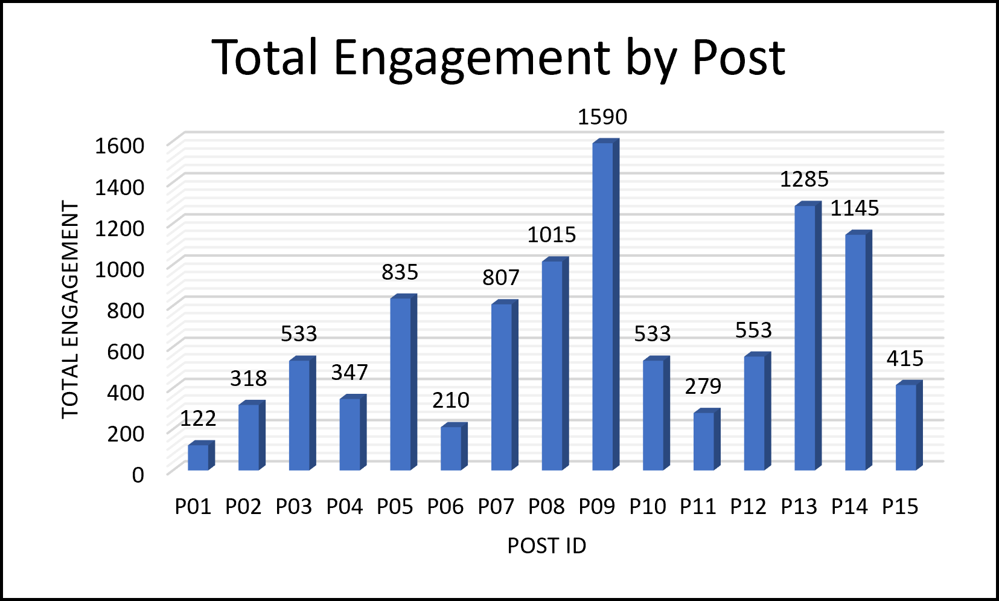
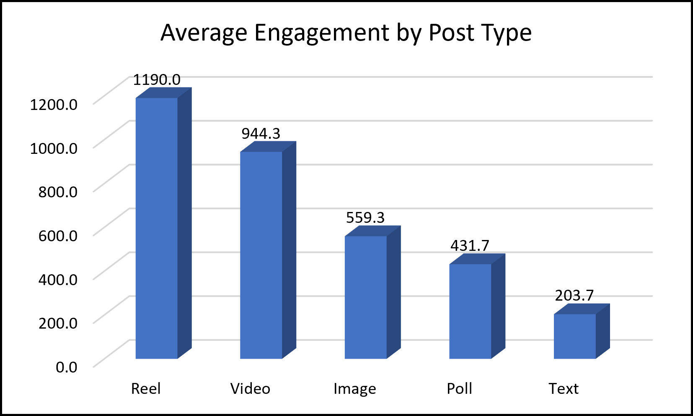

# Task 1: Social Media Engagement Analysis (Excel)

## Objective
Analyse sample social media post data to find which posts and post types get the most engagement.

## Files
- `Task-1.xlsx`: workbook (Data, Summary, Findings sheets)
- `sample_dataset.csv`: dataset (15 simulated posts)
- `findings_report.pdf`: short findings report
- `charts/`: chart screenshots

## Excel skills used
MAX, INDEX/MATCH, COUNTIF, AVERAGEIF, SUMIF, absolute references, column charts

## Key findings
1. Reels (avg 1,190) and Videos (avg 944) outperform Text (avg 204) by a wide margin.
2. Video results vary a lot (533 to 1,285).
3. Polls drive comments (27% per like); Reels drive shares (8.9% per like).

## Charts

*Data is simulated and only 15 posts, so results are indicative.*
